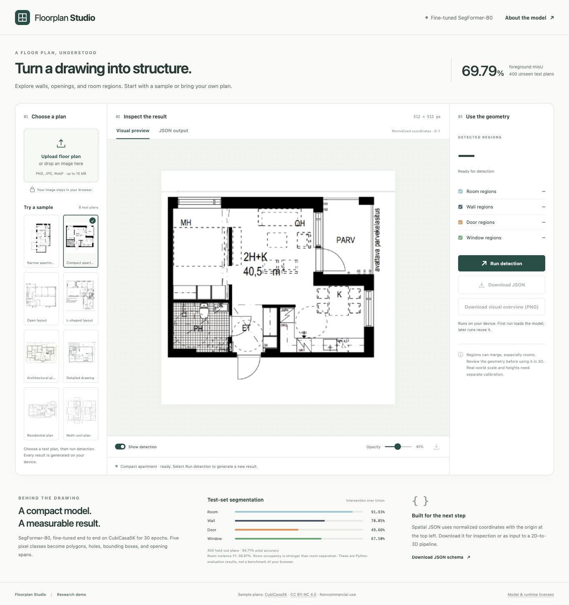
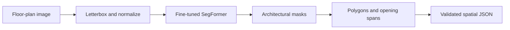

# Floorplan Studio

Detect **walls, doors, windows, and room regions** in 2D floor-plan images, inspect the result, and export spatial JSON. The project includes a fine-tuned SegFormer-B0, a browser demo, and the Python training and evaluation pipeline.

[Training notebook](notebooks/FloorPlan_Colab.ipynb) · [Evaluation results](results/RESULTS.md) · [JSON format](docs/JSON_FORMAT.md) · [Interface guide](web/README.md)



## Try it

Choose one of eight test plans, or upload a PNG, JPEG, or WebP image, then select **Run detection**. The interface starts without results and generates each prediction live. It provides class filters, prediction overlays, region details, a JSON viewer, and JSON/PNG downloads. Images are processed in the browser and stay on the visitor's device.

To run the same interface locally, no Python packages or API keys are needed:

```bash
python3 -m http.server 8765 --bind 127.0.0.1 --directory web/dist
```

Open http://localhost:8765. The first live detection downloads roughly 36 MB of model and runtime files. See [the interface documentation](web/README.md) for browser support, model export, and static hosting.

## Deliverables

| Requirement | Location |
|---|---|
| Browser interface, ready for static hosting | `web/dist/`, `web/README.md` |
| Training, inference, evaluation | `src/floorplan/`, `scripts/`, Colab notebook |
| Fine-tuned weights | `artifacts/segformer/best/` |
| Browser model export | `web/dist/models/floorplan-segformer.onnx` |
| Dataset/preprocessing details | `docs/DATASET.md`, generated dataset audit |
| Unseen-plan evaluation | `results/test/metrics.json`, `results/RESULTS.md` |
| Sample images and JSON | `results/test/samples/` |
| White-background PowerPoint | `presentation/` |

Training ran for 30 epochs on a Colab T4, with **7,857 optimizer steps**. Validation foreground mIoU selected the epoch-28 checkpoint. The ONNX export has identical argmax predictions to PyTorch on all eight exported samples; numerical checks are recorded in `results/browser_export_verification.json`.

## Measured results

Evaluation used **400 unseen test plans**:

| Metric | Result |
|---|---:|
| Foreground mIoU | 69.79% |
| Pixel accuracy | 94.71% |
| Room / wall / door / window IoU | 91.93% / 70.05% / 49.66% / 67.50% |
| Room / door / window instance F1 | 38.87% / 45.84% / 58.63% |
| Room-count MAE | 4.715 rooms per plan |
| Schema-valid JSON | 100% |
| Median model inference on T4, excluding image I/O | 29.3 ms |

Room occupancy segmentation is substantially stronger than individual room separation: connected regions can merge adjacent rooms and open-plan functional areas. The exported geometry is a research demonstration and needs topology review before automatic 3D reconstruction. Schema validity measures JSON structure, not geometric correctness. Full metrics, per-plan scores, and reproducible failure cases are in `results/RESULTS.md` and `results/test/`.

## Approach

SegFormer-B0 combines a hierarchical vision transformer with a compact segmentation decoder. Training initializes from `nvidia/segformer-b0-finetuned-ade-512-512`, replaces the 150-category classifier with a five-category head, and updates the encoder and decoder together through supervised fine-tuning. [Model card](https://huggingface.co/nvidia/segformer-b0-finetuned-ade-512-512).

The five classes are background, room, wall, door, and window. Rooms have a generic `room` category; this version does not predict bedroom/kitchen/bathroom functions. Openings and room instances are connected mask regions, so topology can be imperfect. Wall polygons retain interior holes and can be extruded after physical scale and height are supplied.



## Local installation

Use Python 3.10 or newer. Create an isolated environment in the project directory:

```bash
python3 -m venv .venv
source .venv/bin/activate
python -m pip install -e .
```

CUDA is used automatically when available, then Apple MPS when supported, otherwise CPU. CPU inference is supported; GPU training is recommended. Use `--device cpu`, `--device mps`, or `--device cuda` to select explicitly.

## Dataset and preparation

The official CubiCasa5K archive is approximately 5.47 GB. Only the aligned scaled raster, SVG annotations, and split manifests are extracted. Allow additional disk space for archive chunks, extraction, and cached training images. The downloader validates the official archive checksum and supports resuming completed chunks.

```bash
python scripts/fetch_dataset.py
floorplan prepare --raw data/raw/cubicasa5k --output data/prepared
```

Preprocessing verifies split-ID disjointness and removes exact RGB-image duplicates with priority **test > validation > training**. Within each split, the first manifest occurrence is retained. Every exclusion and its retained counterpart is recorded in the audit. It follows the official annotation selectors and aligned raster coordinate convention, creates 512 × 512 letterboxed images and masks, excludes outdoor spaces, and records source categories, class counts, and hashes. Padding is assigned ignore label 255.

The audited split sizes are **4,179 train / 400 validation / 400 test**. Twenty-one training images were removed: 15 repeated training images, four copies of validation images, and two copies of test images. The retained validation and test sets keep their original 400 plans each. See `results/dataset_audit.json` for every exclusion.

## Training

```bash
floorplan train --data data/prepared --output artifacts/segformer \
  --epochs 30 --batch-size 16 --lr 0.00006 --patience 6 --seed 42
```

The Colab configuration uses batch size 16, verified to fit the allocated T4 GPU at approximately 5.8 GiB peak allocated memory in a forward/backward check. The generic CLI defaults to batch size 4 for smaller devices. Optimizer: AdamW with weight decay 0.01, 5% learning-rate warmup followed by polynomial decay. Loss: inverse-square-root frequency weighted cross-entropy plus foreground soft Dice. Augmentation: 90-degree rotations, horizontal flips, brightness and contrast changes. CUDA uses mixed precision and gradient clipping. Validation foreground mIoU selects the best checkpoint. Early stopping uses six non-improving epochs. Resume with the same configuration and `--resume`.

The job saves the initial five-class checkpoint, per-epoch history, resume state, final best weights, and evidence of encoder parameter changes and optimizer steps. The initial checkpoint contains an untrained task head and is a diagnostic initialization baseline.

## Colab workflow

Open `notebooks/FloorPlan_Colab.ipynb` in Colab and choose a T4 GPU. Upload the source archive produced by `python scripts/package_source.py`. The notebook runs the same project scripts as local execution. The cloud job downloads data, trains, evaluates, and produces a zip of trained weights and results. Download and extract that zip into this project. A free Colab runtime may disconnect or have no GPU available; resume artifacts must be saved before a runtime is lost.

## Inference and spatial JSON

```bash
floorplan infer --checkpoint artifacts/segformer/best \
  --image path/to/unseen_floorplan.png --output results/my_plan
```

The output folder contains `prediction.json`, a class mask, and an overlay. Geometry uses top-left image coordinates normalized as `x/(width-1), y/(height-1)`. Each element includes a class, polygon, optional holes, normalized bounding box, area fraction, and average class probability. Doors and windows include an estimated opening span. The probability is not calibrated confidence.

The JSON schema is packaged with the source. See `docs/JSON_FORMAT.md` for the 3D handoff contract. Physical scale, wall height, sill height, and door height are not inferred. Supply these independently before constructing a dimensionally accurate 3D model.

## Evaluation and verification

```bash
floorplan evaluate --data data/prepared --checkpoint artifacts/segformer/best \
  --output results/test --split test
python scripts/report_results.py
python -m unittest discover -s tests -v
node tests/test_browser_geometry.cjs
python scripts/verify_web.py
```

The deduplicated official test split is held out from training and checkpoint selection. Report pixel accuracy, foreground and class IoU, Dice, true-instance precision/recall/F1 at mask IoU ≥ 0.5, room-count MAE, inference latency, and schema-valid JSON rate. Source SVG polygons define ground-truth instances; connected mask components define predicted instances. Wall-instance scores are diagnostic because adjacent wall segments form a single network. The first eight retained test images are exported in manifest order without selecting for successful predictions.

## Limitations and licensing

Thin openings may disappear at 512-pixel resolution; connected regions can merge adjacent rooms or doors. Hand drawings, unfamiliar plan styles, and scans are outside the training distribution. Geometry is an approximation and may require topology repair downstream. See measured failure cases in the completed result report.

Project-authored code is MIT licensed. CubiCasa5K is **CC BY-NC 4.0**; dataset samples, annotations, derived examples, and learned artifacts carry upstream usage restrictions. SegFormer pretrained weights have NVIDIA's upstream model license. The demo is for noncommercial research use. The dataset and development environment are excluded from version control. See `THIRD_PARTY_NOTICES.md` for model and runtime terms.

## Repository and review bundle

The repository includes the trained checkpoint, export, sample outputs, evaluation records, and PowerPoint. Dataset archives, virtual environments, caches, and local hosting state are ignored. Each individual asset fits within GitHub's ordinary file-size limit; Git LFS is not required for this version.

```bash
python scripts/verify_submission.py
python scripts/package_submission.py
```

The review archive is written to `dist/FloorPlan_Detection_Submission.zip`. [GitHub setup and Pages instructions](docs/GITHUB.md).
